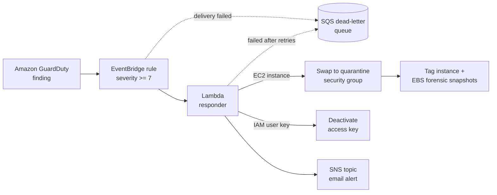

# AWS Threat Containment Automation

Automated incident response for Amazon GuardDuty. When GuardDuty reports a
high-severity finding, this project contains the threat within seconds,
preserves evidence and emails the security team. Everything is defined as code
with Terraform and checked in CI.



*SNS, SQS, CloudWatch Logs and the Lambda's settings are encrypted with one
customer-managed KMS key.*

## What it does

| Finding is about | Automated response |
|---|---|
| An EC2 instance (for example `Backdoor:EC2/C&CActivity.B`) | Moves the instance into a quarantine security group with **no inbound or outbound rules**, tags it `AutoResponse=isolated`, then takes EBS snapshots for forensics |
| An IAM user's access key (for example `UnauthorizedAccess:IAMUser/InstanceCredentialExfiltration`) | **Deactivates** the key (it is not deleted, so it can be investigated or restored) |
| A role's temporary credentials, or any other resource | Sends an alert only: these need a human decision |

Every finding produces an email describing what was done and linking to the
finding in the GuardDuty console.

## Security design decisions

- **Contain first, then collect evidence.** The instance is isolated before
  snapshots start, so an attacker loses network access as early as possible.
- **Least-privilege IAM.** The Lambda role can only describe EC2, manage
  security groups and snapshots in this account and region, deactivate (not
  delete) user access keys, publish to one topic and use one KMS key. See
  [`terraform/iam.tf`](terraform/iam.tf).
- **Dry-run by default.** `dry_run = true` reports what *would* happen without
  changing anything, so the automation can be trusted before it is switched on.
- **Opt-out tag.** Instances tagged `AutoResponseExempt=true` (for example a
  production database that needs a human decision) are reported but never
  isolated.
- **Idempotent.** Already-isolated instances are skipped, so repeated findings
  do not repeat the work.
- **No lost findings.** EventBridge retries delivery, the Lambda retries on
  failure, and anything still failing lands in an encrypted SQS dead-letter
  queue.
- **Encryption everywhere.** One customer-managed KMS key (with rotation)
  encrypts the SNS topic, the dead-letter queue, the Lambda log group and the
  Lambda's environment variables.
- **Secrets stay out of alerts.** Access key IDs are masked (`AKIA...MNOP`) in
  logs and emails.

## Repository layout

```
lambda/src/handler.py          Response logic (Python 3.12, boto3)
lambda/tests/                  Unit tests with fake AWS clients (no AWS needed)
terraform/                     GuardDuty, EventBridge, Lambda, IAM, KMS, SNS, SQS
scripts/send-test-event.sh     Sends a realistic test finding for your own test instance
.github/workflows/ci.yml       Tests, Bandit, terraform validate and Checkov on every push
```

## Deploy

Requirements: an AWS account and Terraform 1.6+. AWS CloudShell (in the AWS
console) works well and needs no local setup.

```bash
cd terraform
cp terraform.tfvars.example terraform.tfvars   # then set alert_email
terraform init
terraform plan
terraform apply
```

Confirm the subscription email that SNS sends you. If GuardDuty is already
enabled in the region, set `create_guardduty_detector = false`.

## Test it

1. **Sample findings (safe):** in the GuardDuty console choose
   *Settings → Generate sample findings*. Sample findings use fake resource
   IDs, so the Lambda reports "not found" and emails you, which shows the whole
   pipeline is wired up.
2. **Real isolation of a test instance:** launch a throwaway `t3.micro`, set
   `dry_run = false`, run `terraform apply`, then:
   ```bash
   bash scripts/send-test-event.sh i-0123456789abcdef0
   ```
   Within a minute the instance's security groups are replaced by the
   quarantine group, it is tagged, its volumes are snapshotted and you get an
   email.

## Clean up

```bash
terraform destroy
```

Also terminate any test instance and delete the forensic snapshots and the
quarantine security group the Lambda created (they are not managed by
Terraform).

## Cost

Almost free at demo scale: Lambda, EventBridge, SNS and SQS stay within the
free tier. The KMS key costs about $1 per month while it exists. GuardDuty has
a 30-day free trial per account and region, then charges by volume of
analyzed events. Snapshots cost a little until deleted.

## Known limitations and next steps

- **Existing connections:** changing an instance's security groups does not
  always cut connections that are already open (security group connection
  tracking). A stronger response would also apply a deny-all network ACL on
  the subnet, or stop the instance after snapshotting.
- **Roles:** temporary role credentials cannot be deactivated like user keys.
  A next step is an opt-in action that revokes the role's active sessions.
- **Single account and region:** for an AWS Organization, deploy through a
  delegated GuardDuty administrator account and route findings from every
  region.
- **Approval step:** for critical workloads, AWS Step Functions could pause
  for a human approval before isolating.

## License

MIT
